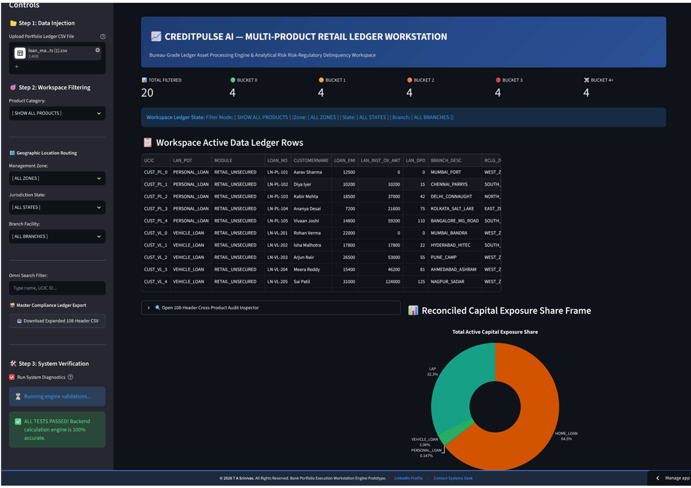
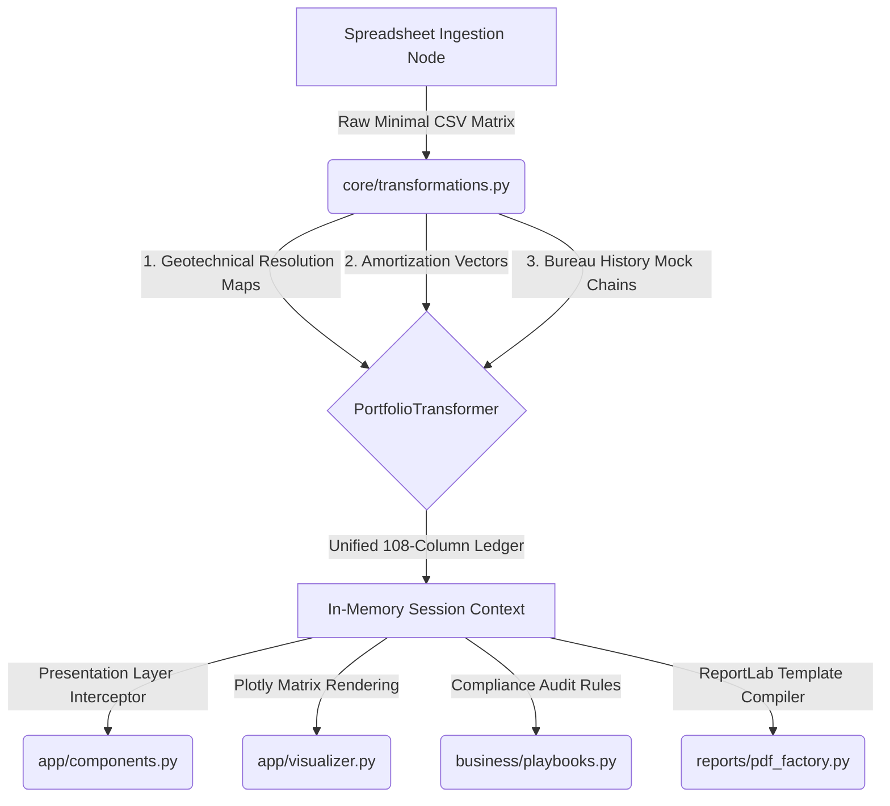
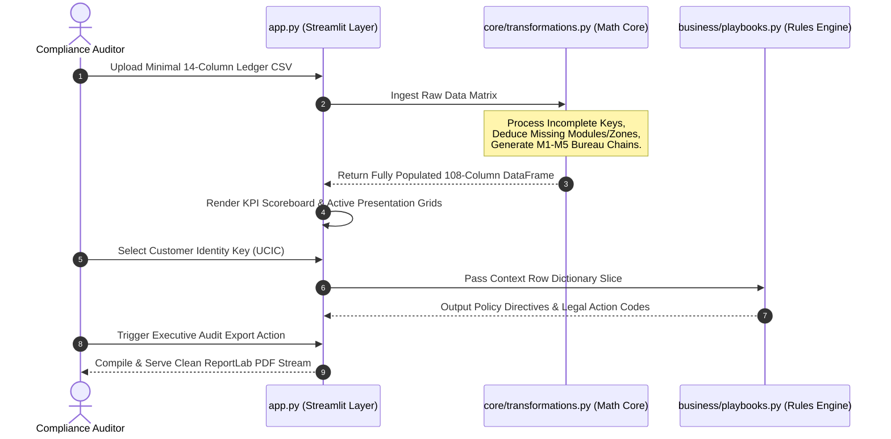

# 📈 CreditPulse AI — Multi-Product Retail Ledger Workstation

An enterprise-ready financial workstation built with Streamlit for processing multi-product retail banking portfolios, risk-regulatory delinquency arrays, and parallel mock analytics across a 108-column bureau compliance ledger schema.



## 🏛️ System Architecture

The workstation decouples transactional computation routines (Zero I/O Core) from presentation layers to maintain a predictable analytical interface.



### Ingestion & Extrapolation Lifecycle Pipeline



---

## 📁 Repository Directory Tree

```text
📁 creditpulse-ai-workstation/
├── 📁 .streamlit/
│   └── config.toml                  # Global Dark-Theme Layout Server Configs
├── 📁 app/
│   ├── __init__.py
│   ├── components.py                # UI Layout Elements & Styles
│   └── visualizer.py                # Plotly Visual Charts Factory
├── 📁 business/
│   ├── __init__.py
│   └── playbooks.py                 # Bureau-Grade Delinquency & Playbook Rules
├── 📁 config/
│   ├── __init__.py
│   └── constants.py                 # Frozen 108-Header Definitions & Interest Maps
├── 📁 core/
│   ├── __init__.py
│   └── transformations.py           # Vectorised Balance Amortization Core
├── 📁 reports/
│   ├── __init__.py
│   └── pdf_factory.py               # ReportLab Compliance Document Compiler
├── 📁 tests/
│   ├── __init__.py
│   └── test_calculations.py         # Math Engine & Fallback Invariant Tests
|   └── test_mock_distribution.py         
├── app.py                           # Modular Application Entrypoint
├── loan_master_portfolio_5_buckets.csv # Geographic Mock Data Matrix File
├── requirements.txt                 # Dependency Framework Metrics
└── setup.py                         # Local Editable Packager Configurations
```

---

## 🚀 Local Host Installation & Boot Instructions

To run the workstation engine locally on your machine, follow these steps:

### 1. Configure the Local Environment & Install Dependencies
```bash
# 1. Access project workspace path
cd creditpulse-ai-workstation

# 2. Spawn targeted Python virtual node
python3 -m venv venv

# 3. Initialize terminal activation link context
# On macOS/Linux:
source venv/bin/activate
# On Windows PowerShell:
.\venv\Scripts\Activate.ps1

# 4. Ingest and compile required packages
pip install -r requirements.txt
```

### 2. Link Local Path Architecture Dependencies
Register the editable setup script mapping to expose internal application directories (`app`, `core`, `config`):
```bash
pip install -e .
```

### 3. Launch the Workstation Server on LocalHost
Boot the UI layer using Streamlit on `port 8501`:
```bash
streamlit run app.py
```
Access the application directly in your browser at:
👉 **`http://localhost:8501`**

### 4. Run Automated Mathematics Diagnostic Suites
Verify math invariants and fallback deduction structures via PyTest:
```bash
pytest -v tests/test_calculations.py
```

---

## 🛡️ License, Copyright & Compliance Notices

**All Rights Reserved © 2026 T A Srinivas.**

Developed exclusively for portfolio demonstration profiles. **DO NOT DISTRIBUTE, CLONE, OR DUPLICATE.** Corporate licensing inquiries can be routed to `tasrinivass@gmail.com`.
